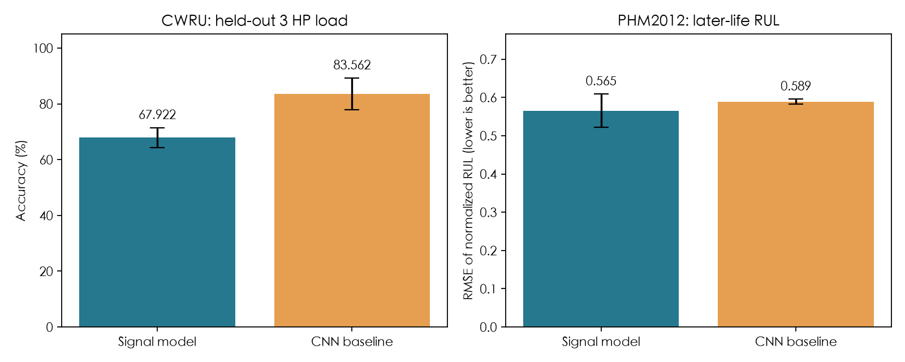

# MFC-LLM 项目复现：信号网络部分

根据李川等《基于多任务特征关联大模型的旋转机械故障预测健康管理研究》公开方法编写的 PyTorch 参考实现。

核心任务可以拆成两步：**先从振动中提取特征，再同时预测“是什么故障”和“还剩多少寿命”。** 本仓库完成信号网络、训练、评估和推理；Qwen、LoRA、信号文本对齐及维护建议生成暂未实现。

原文没有完整给出卷积层配置、参考信号选择、交叉注意力 V 的来源、健康指标构造等细节，本实现的补充选择均在[论文对应与差异](docs/论文对应与差异.md)中列出。它不是作者原始源码，也尚未重现论文报告的效果。

## 最核心的代码

| 文件 | 内容 |
|---|---|
| [mfc/model.py](mfc/model.py) | 一维卷积、通道注意力、交叉注意力、多尺度卷积，分类与 RUL 双分支、联合损失 |
| [mfc/train.py](mfc/train.py) | 训练与反向传播、验证集选权重、测试和结果保存 |
| [mfc/predict.py](mfc/predict.py) | 加载训练权重，输出故障概率和已训练的 RUL 预测 |
| [mfc/data.py](mfc/data.py) | 数据读取、健康参考、残差、窗口、数据划分和 FPT 寿命标注 |
| [mfc/inspect_model.py](mfc/inspect_model.py) | 用一个真实测试样本，逐层查看张量形状和注意力权重 |
| [mfc/suite.py](mfc/suite.py) | 多随机种子、CNN 基线和消融训练入口 |
| [mfc/verify.py](mfc/verify.py) | 检查数据隔离、重算指标、验证权重重载 |
| [configs/signal.json](configs/signal.json) | 网络和训练参数 |

```text
当前振动 q + 健康参考 r
          ↓ 残差 q-r；各自标准化
一维卷积 → 通道注意力 → 交叉注意力 → 多尺度卷积
          ↓ 1024维共享特征
          ├─ 分类分支 → 故障类别概率
          └─ 回归分支 → 剩余寿命 RUL
```

交叉注意力默认 Q 来自当前信号、K 来自健康参考、V 来自残差；V 的默认来源属于对原文缺失信息的补充。CWRU 没有寿命真值，其回归分支不参与训练，推理接口会将 RUL 标记为 `untrained`。

## 已运行的结果

两套真实公开数据、两种模型，每种组合运行随机种子 42、43、44，共 12 次训练。均值如下：

| 模型 | CWRU 十分类准确率 | PHM2012 RUL RMSE ↓ |
|---|---:|---:|
| 完整信号模型 | 67.92% | 0.5652 |
| 普通 CNN 基线 | 83.56% | 0.5889 |



CWRU 按负载划分：0/1 HP 训练，2 HP 验证，3 HP 测试。这是跨负载测试，不等于跨物理轴承测试。PHM2012 使用 Bearing3_1、Bearing3_2 的 2152 条记录，按每条轨迹前55%训练、接着15%验证、最后30%测试；RUL 为 FPT 到终点的归一化寿命，误差单位不是分钟。

分类没有超过 CNN，寿命预测曲线也仍有明显偏差。完整结果、FPT 问题、参数差异和失败情况见[实际运行报告](docs/实际运行报告.md)。这里的 PHM 健康/退化标签由 FPT 派生，不是人工标注的故障类型。

## 仓库包含哪些实验产物

- `results/`：12 次实验的指标、逐样本预测、训练历史、配置、结果图和原始核验记录。
- `results/cwru/full_seed42/best.pt`：CWRU 完整信号模型示例权重。
- `results/phm2012/full_seed42/best.pt`：PHM2012 完整信号模型示例权重。
- `data_info/`：数据划分说明、窗口来源和标签审计清单。

其余种子的权重可通过下方命令重新训练得到。原始数据和处理后的信号数组采用脚本下载、生成；论文 PDF 与本机运行环境不在此仓库内。

## 安装与快速检查

推荐 Python 3.12；代码使用 Python 3.10+ 语法。

```bash
python3 -m venv .venv
source .venv/bin/activate
python -m pip install -r requirements.txt
python -m pytest -q
```

`requirements.lock.txt` 记录本次 macOS/Apple Silicon 实际运行版本，其他平台应按自身环境选择兼容的 PyTorch。运行不需要大模型 API。

## 下载 CWRU，查看已有权重输出

```bash
python -m mfc.download
python -m mfc.data cwru
python -m mfc.inspect_model
```

最后一条命令会读取真实测试样本，打印四个核心模块的中间形状、注意力权重、真实类别和预测类别。先前执行的输出也保存在 [results/真实样本逐模块输出.txt](results/真实样本逐模块输出.txt)。

## 自己重新训练

使用新的 `runs/` 输出目录，保留已有实验记录：

```bash
python -m mfc.train --data data/cwru --out runs/cwru/full_seed42 --variant full --seed 42 --device cpu
python -m mfc.verify --data data/cwru --run runs/cwru/full_seed42
```

多种子与 CNN 比较：

```bash
python -m mfc.suite --data data/cwru --out runs/cwru_comparison --variants full cnn --seeds 42 43 44 --device cpu
```

另有 `no_channel`、`no_cross`、`no_multiscale` 三个消融选项。已完成其前向/反向检查；实现选项不代表已完成对应真实数据消融实验。

## 剩余寿命预测

```bash
python -m mfc.download_phm
python -m mfc.data phm2012 --root data/raw/phm2012 --out data/phm2012 --length 2560
python -m mfc.train --data data/phm2012 --out runs/phm2012/full_seed42 --variant full --seed 42 --device cpu
python -m mfc.verify --data data/phm2012 --run runs/phm2012/full_seed42
```

PHM2012 的单条采样有 2560 点，因此直接使用单条记录。不会把相隔10秒的两条采样拼成连续波形以凑到4096点。该选择与原文输入长度存在差异。

## 对自己的信号推理

准备 `query.npy` 和 `healthy.npy`，形状为 `[N,2,L]`，健康参考也可为 `[2,L]`。采样率、通道、窗口和参考约定应与所用权重一致。

```bash
python -m mfc.predict --checkpoint results/cwru/full_seed42/best.pt --query query.npy --reference healthy.npy --out runs/predictions.json
```

输出包含 `class_name`、`class_probabilities`、`rul_status` 和 `rul_raw`。CWRU 权重不会输出具有寿命意义的 RUL；请使用 PHM 权重进行寿命推理，并保留同目录 `config.json`。

## 复现范围与来源

- 数据来源、原文公式与实现差异：[论文对应与差异](docs/论文对应与差异.md)。
- 实验结果和局限：[实际运行报告](docs/实际运行报告.md)。
- 初次实现和实验执行由 Codex 根据用户要求辅助完成。后续自行编写、复跑、调试和改进的部分应分别记录，不把自动生成的代码或复现实验直接当作原创科研贡献。
- 数据属于原发布者，使用时应遵守其条款并引用原始数据论文。
