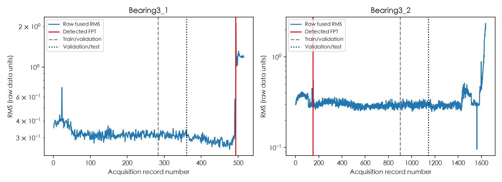
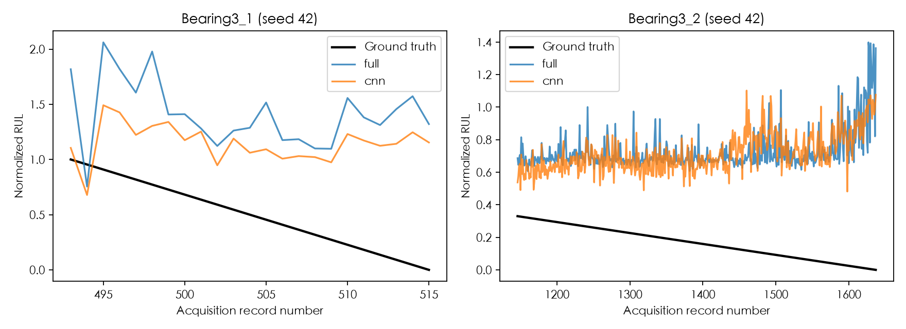

# 实际运行报告

这是根据落盘配置、权重和逐样本预测生成的报告。测试结果已独立重算；下面没有填入论文分数作为本次成绩。

## 数据与任务

| 数据 | 训练/验证/测试样本 | 实际任务 |
|---|---|---|
| cwru | 1164 / 291 / 292 | 十类故障分类，4096点/窗 |
| phm2012 | 1181 / 322 / 647 | FPT派生健康状态分类 + RUL回归，2560点/窗 |

CWRU来源为官方40个MAT文件；训练0/1HP，验证2HP，测试3HP。PHM来源为固定GitHub镜像的2152条原始CSV；Bearing3_1有515条，Bearing3_2有1637条。两套数据分别训练，不把不同采样率的信号混作同一任务。

PHM每条轨迹前55%训练、接着15%验证、后30%测试；RUL仅在FPT后有标签。按采集文件隔离集合，先划分再切窗；CWRU训练内部允许重叠，但训练与验证、测试没有相同采集文件。

## 多随机种子的实际结果

均值 ± 标准差采用种子间总体标准差；种子不是新的独立轴承，不能把三次训练当作三套独立数据。

| 模型 | CWRU测试准确率 | CWRU宏F1 | PHM RUL RMSE | PHM RUL MAE |
|---|---:|---:|---:|---:|
| 完整信号模型 | 67.92 ± 3.54% | 0.6402 ± 0.0527 | 0.5652 ± 0.0438 | 0.5393 ± 0.0380 |
| 普通CNN基线 | 83.56 ± 5.71% | 0.7986 ± 0.0646 | 0.5889 ± 0.0068 | 0.5568 ± 0.0042 |

RUL误差单位是FPT到终点之间的归一化剩余寿命，不是分钟。回归输出没有截断到[0,1]。两个模型参数量不同，CNN也不是作者原基线的精确架构。

## 每次运行

| 数据 | 模型/种子 | 验证选中epoch | 测试准确率 | 宏F1 | RUL RMSE | 参数量 |
|---|---|---:|---:|---:|---:|---:|
| cwru | full / 42 | 48 | 0.6952 | 0.6599 | 无寿命标签 | 1,403,539 |
| cwru | full / 43 | 39 | 0.7123 | 0.6926 | 无寿命标签 | 1,403,539 |
| cwru | full / 44 | 14 | 0.6301 | 0.5682 | 无寿命标签 | 1,403,539 |
| cwru | cnn / 42 | 17 | 0.7568 | 0.7084 | 无寿命标签 | 537,419 |
| cwru | cnn / 43 | 37 | 0.8904 | 0.8563 | 无寿命标签 | 537,419 |
| cwru | cnn / 44 | 44 | 0.8596 | 0.8313 | 无寿命标签 | 537,419 |
| phm2012 | full / 42 | 28 | 0.9382 | 0.9136 | 0.6101 | 1,402,507 |
| phm2012 | full / 43 | 41 | 0.9382 | 0.9140 | 0.5799 | 1,402,507 |
| phm2012 | full / 44 | 13 | 0.9444 | 0.9219 | 0.5058 | 1,402,507 |
| phm2012 | cnn / 42 | 15 | 0.9073 | 0.8716 | 0.5876 | 536,387 |
| phm2012 | cnn / 43 | 23 | 0.8594 | 0.8208 | 0.5977 | 536,387 |
| phm2012 | cnn / 44 | 19 | 0.9073 | 0.8686 | 0.5813 | 536,387 |

全部epoch仅依据验证集联合损失选择；测试集不参与epoch选择。全套实验使用预先固定设置，不为改善已观察到的测试分数重新调参。

## 寿命预测为何不能只看一个平均数

| 轴承 | 原始记录数 | FPT确认记录号（从1开始） |
|---|---:|---:|
| Bearing3_1 | 515 | 493 |
| Bearing3_2 | 1637 | 149 |

本实现中Bearing3_1的FPT位于训练/验证段之后，所以训练时没有它的FPT后RUL标签；回归主要从Bearing3_2的训练段学习。这是当前FPT定义与划分的实际结果，没有从测试段补取训练标签。

Bearing3_2的FPT较早，之后RMS又长期平稳。这个FPT是本实现的HI与阈值产生的事件，不是数据集提供的人工故障发生时间；应先核对健康指标和阈值选择，再解释寿命误差。原文缺少的HI融合细节可能实质改变这一结果。

下图只画测试集中FPT之后的有标签点，各轴承分开显示，避免把不同寿命曲线连成一条。

| 轴承（seed42） | 模型 | 有效RUL测试点 | RMSE | MAE |
|---|---|---:|---:|---:|
| Bearing3_1 | full | 23 | 0.9793 | 0.9296 |
| Bearing3_1 | cnn | 23 | 0.7248 | 0.6714 |
| Bearing3_2 | full | 492 | 0.5872 | 0.5592 |
| Bearing3_2 | cnn | 492 | 0.5804 | 0.5482 |

仅预测训练集有标签RUL均值的常数基线：RMSE=0.5830，MAE=0.5709。这个数只由训练标签构造，不利用测试均值。

训练段有效RUL真值范围为0.4953到1.0000；后期测试的许多目标低于该区间，包含实质性外推。窗口内标准化与参考选取也可能影响退化敏感性，当前对比没有隔离其贡献。

## 能说明什么

这次实验验证了完整信号方法可以训练、保存、重载，并在真实公开数据上产生可核对预测。某个模型若没有超过CNN或常数基线，结果照实保留；不能用复杂模块数量代替实验效果。

它没有验证原论文七个数据集的平均成绩、独立设备泛化或维护建议质量。CWRU是跨负载而非跨物理轴承；PHM是同轨迹后期预测，且健康标签为FPT派生标签。不能将二者的分类准确率混为一个综合成绩。

卷积细节、V的来源、FPT实现、batch大小和输入长度存在公开信息缺口与补充设定；详见[论文对应与差异](论文对应与差异.md)。

## 文件如何核查

本机完整实验的每个运行目录保留best.pt、config.json、history.jsonl、test_predictions.csv、metrics.json及verification.json。GitHub精简仓库保留12次实验的配置、指标、预测和核验记录，示例权重仅保留CWRU与PHM2012完整信号模型的seed42。其余权重需重新训练后生成。

按README下载和预处理数据后，可用`python -m mfc.verify --data data/cwru --run results/cwru/full_seed42`重新核对示例权重。`results/final_verification.json`记录的是本机完整实验的核验情况，不代表精简仓库已经包含全部原始数据与12份权重。

源码和本次执行由Codex完成；用户后续自行实现、调试、复跑、改进的部分应分别记录，不能把本报告直接表述为自己已独立完成的科研成果。
